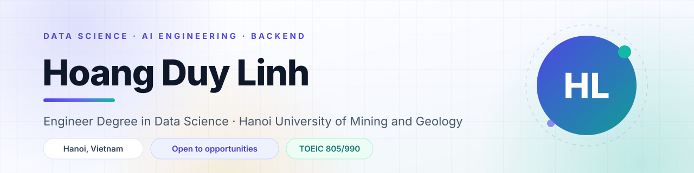

  

  <i>I build reliable AI systems — from guardrailed LLM agents to production-grade backends.</i>

---

## 👋 About me

- 📍 **Based in** — Hanoi, Vietnam
- 🎓 **Education** — Engineer Degree in Data Science, Hanoi University of Mining and Geology *(2022 – 2027 expected)*
- 🧠 **Focus** — LLM agents · RAG · Text-to-SQL · Trust & safety · Backend engineering
- 🗣️ **Languages** — Vietnamese (native) · English (TOEIC 805/990)

I'm a Data Science student who likes the unglamorous parts of AI: schema-aware retrieval, AST guardrails, retry loops, and test suites that keep an agent honest. Lately I've been shipping agentic analytics over real e-commerce data, healthcare APIs on FHIR R4, and fraud-detection scoring for social platforms.

---

## 🧰 Tech stack

**Languages**

**AI & LLM engineering**

**Backend**

**Data & infrastructure**

**Tooling**

---

## 💼 Experience

### AI Engineer Intern · **VinSmart Future**

`Sep 2026 – Nov 2026` · Hanoi, Vietnam

- Built a **Trust & Fraud Detection** module for a social friend-recommendation system, featuring a **4-pillar trust scoring engine** (Authenticity, Interaction, Network, Content) and a **4-tier risk classification policy** to isolate bot and malicious accounts.
- Built a **DevSecOps pipeline** with pre-commit hooks (Ruff, Gitleaks) and GitHub Actions running **130+ Pytest tests (85%+ coverage)**, pip-audit and Bandit on every pull request — catching issues locally and before merge.

### Backend Engineer Intern · **FPT Software**

`Mar 2026 – Aug 2026` · Hanoi, Vietnam

- Built custom **FHIR R4 operations** (Medplum, Node.js, TypeScript) for **CareMate**, a healthcare platform, including a geospatial search API filtering clinics by proximity and real-time slot availability.
- Engineered an automated cron bot and scheduler to track **medication adherence**, processing FHIR `Task` states and dispatching multi-language push notifications to patients.
- Implemented a **multi-channel messaging system** on FHIR `Communication`, supporting topic-based group threads and private 1-on-1 chats.
- Developed practitioner onboarding with **Redis-based OTP verification**, automated profile creation and multi-tenant access policies; maintained API documentation.

---

## 🚀 Featured projects

### 🗣️ [Conversational Analytics Agent — Text-to-SQL](https://github.com/hduylinh7/conversational-analytics-agent)

`LangGraph` · `FastAPI` · `PostgreSQL` · `Redis` · `sqlglot` · `Docker` — **[view repository →](https://github.com/hduylinh7/conversational-analytics-agent)**

A bilingual analytics agent that turns business questions into safe, executable SQL over ~100k e-commerce orders.

- **Agent graph** — `retrieve → generate → validate → execute → finalize`, with a self-repair loop that feeds guardrail and database errors back to the LLM.
- **Zero-trust execution** — a `sqlglot` AST guardrail blocks DML/DDL mutations, clamps `LIMIT` clauses and enforces query timeouts and row caps against destructive or runaway queries.
- **Bilingual semantic layer** — YAML metrics and join paths with hybrid retrieval (n-grams + vector embeddings, Vietnamese diacritic-insensitive), avoiding fan-out and chasm-trap joins.
- **Async backend** — SSE streaming of agent node transitions, 3-tier Redis caching, token-bucket rate limiting, Redis checkpointer for multi-turn state, and a 4-layer Pytest evaluation suite.

### 📚 [AI Learning Companion Agent](https://github.com/hduylinh7/P-043)

`LangGraph` · `Qdrant` · `FastAPI` · `PostgreSQL` · `Redis` · `Docker` — **[view repository →](https://github.com/hduylinh7/P-043)**

Backend and agent layer for an academic planning and tutoring assistant, built in a team.

- **Agent orchestration** — LangGraph state management with conditional workflows for planning and tutoring.
- **Multimodal RAG** — Gemini Vision + Gemini Embeddings + Qdrant to retrieve from PDFs, slides, documents and spreadsheets.
- **Tool calling** — Groq Llama 3.3 for intent classification and tools (study scheduling, Socratic tutoring under academic-integrity constraints), served through async FastAPI APIs and deployed with Docker Compose.

---

## 📊 GitHub in numbers

---

## 🎓 Education & certifications

**Hanoi University of Mining and Geology** — Engineer Degree in Data Science
`Oct 2022 – Feb 2027 (expected)`

| Certification | Issuer |
|:--|:--|
| 🏅 AI Talents Practical Training Program | VinUniversity & Vingroup |
| 🌐 TOEIC 805/990 | ETS |

---

## 📫 Let's connect

I'm happy to talk about LLM agents, retrieval, backend architecture — or a role where I can build these in production.

📞 0842 951 626 · Hanoi, Vietnam

